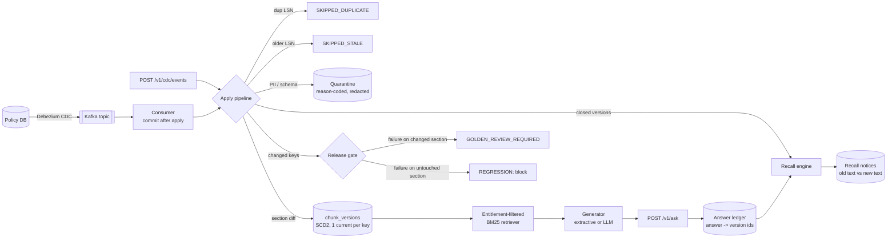

# rag-answer-recall

[](https://github.com/thotakrishna712-lgtm/rag-answer-recall/actions/workflows/ci.yml)
[](https://github.com/thotakrishna712-lgtm/rag-answer-recall/actions/workflows/codeql.yml)
[](https://github.com/thotakrishna712-lgtm/rag-answer-recall/actions/workflows/release-gate.yml)


**Change-aware RAG: when a source document changes, find every answer that was already served from the old text, recall it, and re-test only what the change touched.**

Most RAG pipelines keep the index fresh. Very few can answer the question a compliance team asks the day after a policy changes:

> *"Who did the assistant tell the old retention period to, and what exactly were they told?"*

This project makes that question a single API call. It consumes Debezium CDC events, versions every chunk as SCD Type 2, records which chunk *versions* each answer cited, and raises a recall notice the moment a cited version is superseded or deleted. The release gate understands the same change set, so a golden question whose source section changed is sent to the policy owner for review instead of being mistaken for a model regression.

The same pipeline ships twice: a SQLite reference implementation that runs anywhere in seconds, and a Spark / Delta implementation for Databricks (`foreachBatch` MERGEs into Unity Catalog tables, deployed with Asset Bundles). CI proves the two produce identical state.

Runs fully offline (no API keys), with optional Kafka, MLflow and LLM adapters.

---

## Architecture



## What happens on one CDC event

| Step | Behaviour |
|---|---|
| Idempotency | Every event is keyed by source LSN. A redelivered LSN is a no-op, an LSN older than the policy's last applied LSN is `SKIPPED_STALE`. Apply runs in a single `BEGIN IMMEDIATE` transaction, so a crash mid-apply rolls back and the redelivery applies cleanly. |
| Guardrails | Pydantic validation with reason codes (`MISSING_REQUIRED_FIELD`, `SCHEMA_VALIDATION_FAILED`, `MALFORMED_ENVELOPE`) and a PII scan (SSN, Luhn-checked card numbers, email). Rejects go to quarantine with the raw payload **redacted**, so quarantine never becomes a second copy of the leak. |
| Section diff | Policies are chunked by heading into stable keys (`POL-WIRE-001::audit-log-retention`; section numbering is ignored). Checksums decide `added / modified / removed / unchanged`; unchanged sections are not re-embedded. Owner or effective-date edits update live rows in place without recalling anything. Moving a section to another department *is* a new version, because it changes who may see it. |
| Versioning | Superseded rows get `valid_to_lsn` and a `close_reason`; a partial unique index enforces one current version per chunk key. |
| Recall | Every answer served is ledgered with the exact version ids it cited. Closing a version recalls only the answers that cited it, once, with the superseded and replacement text. |
| Retrieval | BM25 over current versions only. Entitlements are applied **before** scoring, so restricted text cannot leak through ranking or snippets. The service refuses when the top hit covers less than half of the question's IDF-weighted terms. |

## Quickstart

```bash
python -m venv .venv && source .venv/bin/activate
pip install -e ".[dev]"

make test        # 44 tests, strict mypy, ~87% coverage
make spark-test  # 5 Spark parity tests vs SQLite reference (needs Java 17)
make demo        # end-to-end walkthrough (output below)
make gate        # release gate over data/cdc/updates.jsonl
make reconcile   # index vs source-of-truth reconciliation
make api         # http://127.0.0.1:8000/docs
```

### Demo output (abridged)

```text
3. Release: CDC stream with replay, late event, PII leak, bad schema, delete
  lsn=200 POL-WIRE-001 -> APPLIED  modified=1 removed=0 unchanged=3 recalled=['ans-0001']
  lsn=200 POL-WIRE-001 -> SKIPPED_DUPLICATE
  lsn=150 POL-WIRE-001 -> SKIPPED_STALE
  lsn=210 POL-ACC-003 -> QUARANTINED [PII_DETECTED]
  lsn=220 POL-AML-002 -> QUARANTINED [MISSING_REQUIRED_FIELD]
  lsn=225 POL-ACC-003 -> APPLIED  modified=0 removed=0 unchanged=3 recalled=[]
  lsn=230 POL-INC-004 -> APPLIED  modified=0 removed=2 unchanged=0 recalled=['ans-0005']

4. Answer recall: who was told something that is no longer true?
  RECALL #1 answer=ans-0001 reason=SECTION_MODIFIED lsn=200
    question:    How long must wire transfer audit logs be retained?
    was based on: Wire transfer audit logs must be retained for 7 years in immutable sto...
    now says:     Wire transfer audit logs must be retained for 10 years in immutable st...
  answer ans-0001: RECALLED How long must wire transfer audit logs be retained?
  answer ans-0002: FRESH    What wire transfer amount requires dual control approval?
  answer ans-0005: RECALLED How quickly must a Severity 1 incident be acknowledged?

6. Targeted release gate: only golden cases touched by this release
  gate: PASSED (3 cases)
  owner review required: ['g01-wire-retention', 'g09-sev1-ack', 'g10-postmortem']
  regressions: none
```

Full output: [`reports/demo_output.txt`](reports/demo_output.txt).

## API

| Method | Path | Purpose |
|---|---|---|
| `POST` | `/v1/ask` | Answer with citations. Groups from `X-User-Groups` (stand-in for JWT claims). |
| `GET` | `/v1/answers/{id}` | `FRESH` or `RECALLED`, cited versions, recall notices. |
| `POST` | `/v1/cdc/events` | Apply a batch of raw Debezium envelopes. |
| `GET` | `/v1/recalls?since_id=` | Recall feed for notification jobs (cursor-based). |
| `GET` | `/v1/policies/{id}/history` | SCD2 timeline per chunk. |
| `GET` | `/v1/quarantine` | Reason-coded rejects (PII redacted). |

```bash
curl -s -X POST localhost:8000/v1/ask -H "X-User-Groups: retail_analyst" \
  -H "Content-Type: application/json" \
  -d '{"question":"How long must wire transfer audit logs be retained?"}'
```

## Release gate

```text
$ python -m ragrecall.evaluate --apply data/cdc/updates.jsonl
RELEASE GATE PASSED (full, 11 cases)
  retrieval_hit_rate   1.000  (min 0.90)
  answer_correctness   1.000  (min 0.90)
  groundedness         1.000  (min 0.95)
  GOLDEN_REVIEW_REQUIRED  g01-wire-retention  (source section changed; owner must confirm)
  GOLDEN_REVIEW_REQUIRED  g09-sev1-ack  (source section changed; owner must confirm)
  GOLDEN_REVIEW_REQUIRED  g10-postmortem  (source section changed; owner must confirm)
```

The golden set includes entitlement cases (a retail analyst must be refused AML content) and out-of-scope cases (must refuse). `--mode targeted` evaluates only cases whose expected section changed, for fast PR feedback. With `MLFLOW_TRACKING_URI` set, metrics and the full report are logged to MLflow. The `release-gate` workflow runs this on every PR and writes the result to the job summary.

## Databricks implementation

`src/ragrecall/lakehouse.py` plans each micro-batch as DataFrames and MERGEs it into Delta:

| Step | Spark / Delta |
|---|---|
| Parse | `from_json` over the Kafka `value` with the Debezium envelope schema |
| Validate | UDF reusing the core Pydantic contract and PII scanner; rejects go to `quarantine` |
| Order | `row_number()` per `policy_id` by LSN, then anti-join on the `policies.last_lsn` watermark |
| Diff | chunk UDF (same chunker), joined to current versions: `to_close`, `to_insert`, `to_refresh` |
| Recall | citations x closed versions x `FRESH` answers, MERGEd on `(answer_id, version_id)` |
| Write | MERGE closes, MERGE metadata, idempotent append (`txnAppId`/`txnVersion`), watermark last |

Every step is idempotent, so a replayed micro-batch converges without duplicates. `tests/spark` runs the planner on local Spark against the SQLite reference: same final checksums, same close reasons, same quarantine codes, replay is a no-op.

```text
databricks/
  databricks.yml            Asset Bundle (dev / prod targets, wheel artifact)
  resources/jobs.yml        continuous CDC job + release-gate job (serverless)
  jobs/cdc_chunk_versions.py Kafka readStream -> foreachBatch(plan + MERGE)
  sql/001_tables.sql        Unity Catalog DDL, liquid clustering, CDF, row filter by department
infra/terraform/            KMS-encrypted, versioned, private S3 landing zone + read policy
```

`chunks_current` (a view over `chunk_versions WHERE is_current`) is the Delta Sync source for Mosaic AI Vector Search, so superseded text is never embedded or retrieved.

## Index reconciliation

```bash
python -m ragrecall.reconcile --events data/cdc/snapshot.jsonl data/cdc/updates.jsonl
```

Replays the source events independently, re-chunks the latest valid version of each policy, and compares against what the retriever can see: counts, missing keys, unexpected keys (for example, sections of a deleted policy still live) and checksum drift. Used as a cutover sign-off and as a nightly control; the release-gate workflow runs it on every PR.

## Streaming stack

```bash
make up       # Redpanda + API + Kafka consumer (shared state volume)
make events   # publish snapshot + release events, keyed by policy_id
curl -s localhost:8000/v1/recalls
```

The consumer disables auto-commit and commits each offset only after the event is applied. Combined with LSN idempotency, this gives effectively-once results without Kafka transactions. Debezium tombstones are committed and skipped.

## Project layout

```text
src/ragrecall/
  cdc.py          Debezium envelope parsing, reason codes
  security.py     PII detection (Luhn-checked cards) and redaction
  chunker.py      heading-aware chunks, stable keys, checksums, overlap windows
  store.py        SQLite: SCD2 chunk versions, answer ledger, recalls, quarantine
  pipeline.py     idempotent apply, section diff, recall trigger
  retriever.py    entitlement-filtered BM25 + query coverage
  generator.py    extractive generator (single-section, fully grounded)
  service.py      application service used by API, CLI and consumer
  evaluate.py     release gate with golden drift classification, MLflow logging
  reconcile.py    index vs source-of-truth reconciliation
  lakehouse.py    Spark / Delta planner and MERGEs for Databricks
  api.py          FastAPI app factory
  adapters/       Kafka consumer, OpenAI generator (optional extras)
databricks/       Asset Bundle, streaming job, Unity Catalog DDL
infra/terraform/  S3 landing zone
data/             sample policies, Debezium fixtures, entitlements, golden set
docs/             design notes and Databricks mapping
```

## Design notes

See [`docs/DESIGN.md`](docs/DESIGN.md) for the decisions and trade-offs, and [`docs/DATABRICKS.md`](docs/DATABRICKS.md) for how each table maps to Delta, Unity Catalog and Mosaic AI Vector Search.

## Roadmap

- Embedding retriever behind the same interface (hybrid BM25 + vectors)
- Recall notifications to Slack or email from the `/v1/recalls` cursor
- Semantic diff, so a typo fix does not recall an answer while a changed number does
- Per-answer "still true?" re-verification before notifying users

## Contributing and security

See [CONTRIBUTING.md](CONTRIBUTING.md), [SECURITY.md](SECURITY.md) and the [CHANGELOG](CHANGELOG.md). Design walkthroughs and runbooks live in the [wiki](../../wiki).

## License

MIT
